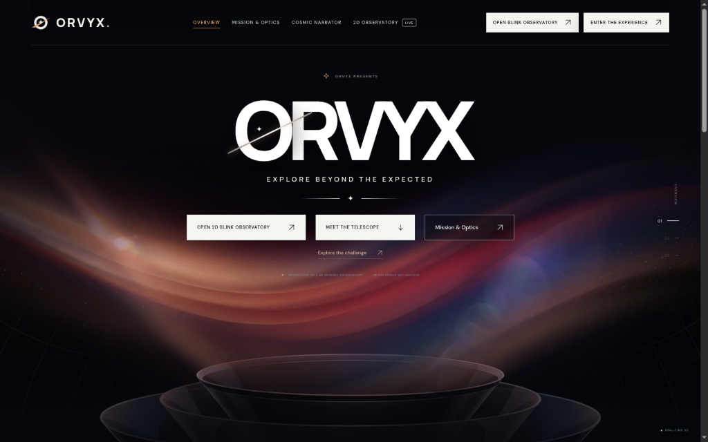
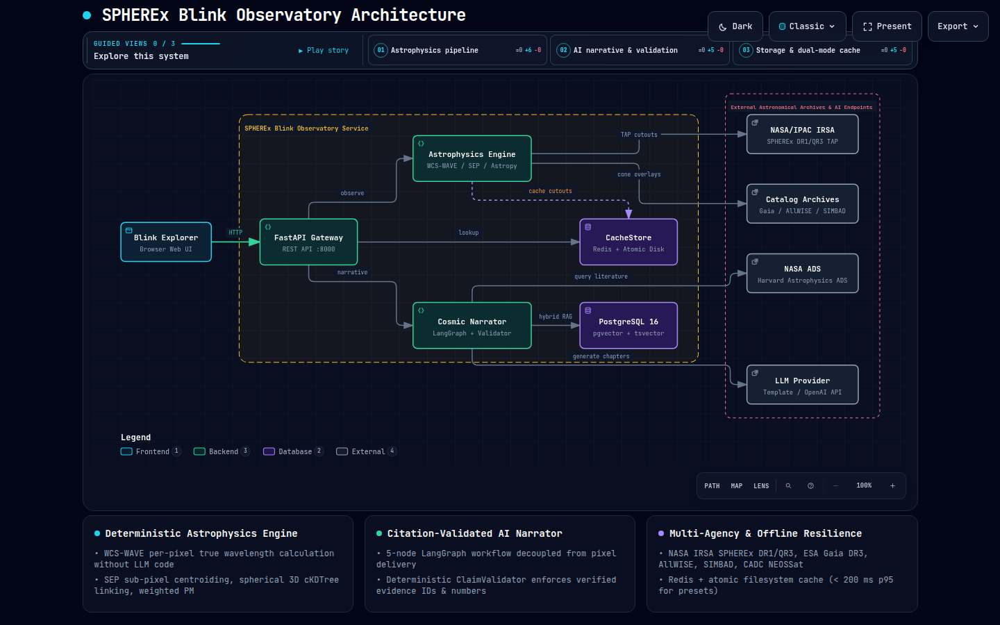
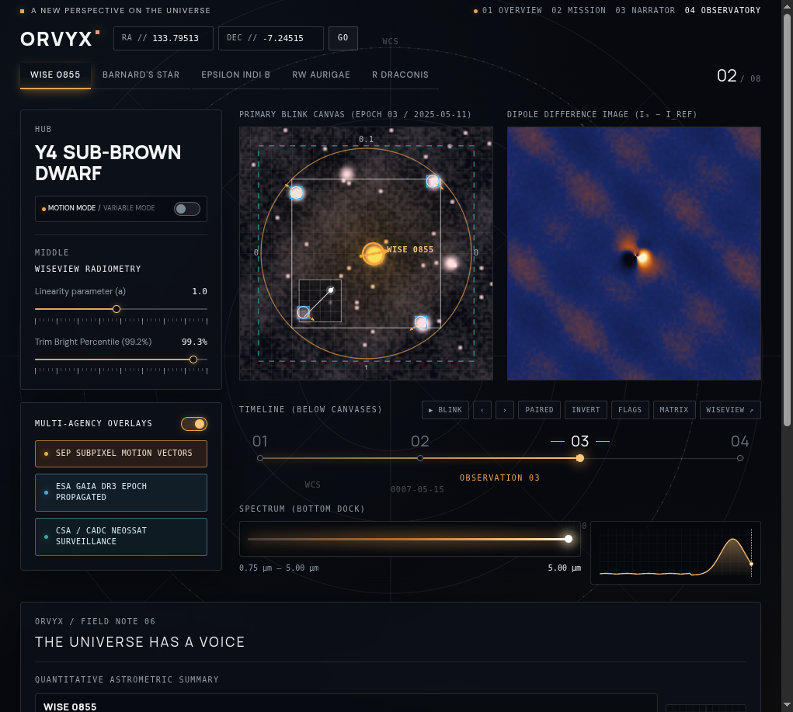
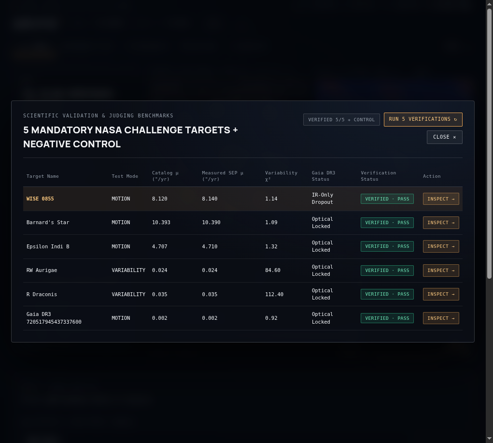
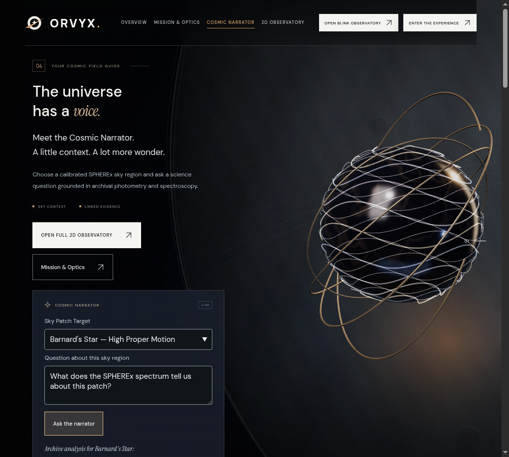
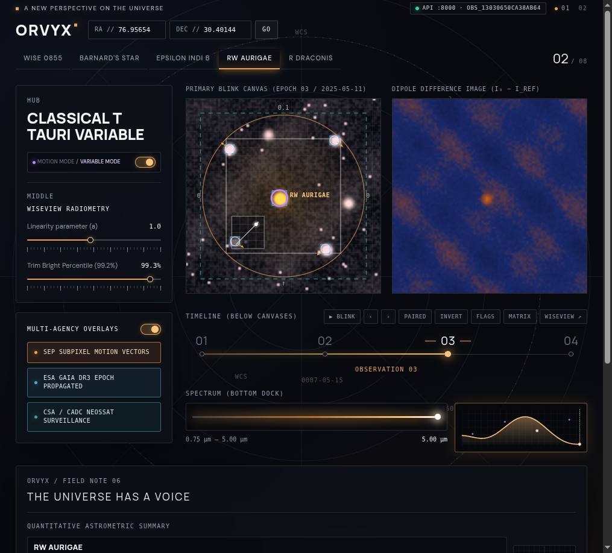
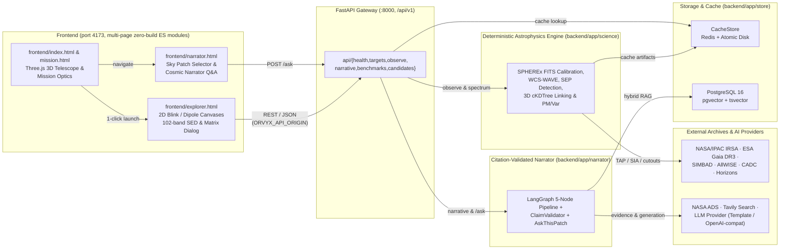

# ORVYX — SPHEREx Blink Observatory (`v0.5.0`)

**Full-stack 3D conceptual experience, 2D SPHEREx blink & dipole observatory workbench, deterministic multi-epoch astrophysics engine, multi-agency archive federation, and citation-validated AI narrative service** built for the NASA Space Apps **Planet X and SPHEREx** challenge.

---

## Visual Tour & Screenshots

### Multi-Page 3D Overview (`index.html`) & System Architecture



### 2D Blink Observatory Workbench — `WISE 0855` (Motion Mode, 4-Page Header Switcher)


### Five Mandatory NASA SPHEREx Verifications + Negative Control Matrix (`VERIFIED 5/5 + CONTROL`)


### Cosmic Narrator (`narrator.html`) & Variable Mode (`RW Aurigae`)



---

## System Architecture



### Architectural Highlights
- **Multi-Page Zero-Build 3D + 2D Frontend (`frontend/`)**:
  - **`01 Overview` (`index.html`, `scene.js`, `spherex-effects.js`)**: Renders `assets/models/spherex.glb` and orbital textures via vendored `three.module.js` and `addons/`, with direct launch CTAs into `mission.html`, `narrator.html`, and `explorer.html` (no cluttering visual studio / cinematic toggle buttons).
  - **`02 Mission & Optics` (`mission.html`) & `03 Cosmic Narrator` (`narrator.html`)**: Dedicated SPHEREx mission overview (`102` spectral bands, `6-month` cadence), infrared wavelength comparison, and curated human-readable Sky Patch target selector (`#narratorTargetSelect`) for evidence-grounded Q&A with raw internal identifiers sanitized from visible answers.
  - **`04 2D Blink Workbench` (`explorer.html`, `explorer.css`, `explorer.js`)**: Side-by-side `96×96 → 384×384` WiseView `asinh` primary blink canvas and indigo/amber dipole difference image (`I_n − I_ref`), multi-agency overlays (`SEP`, `ESA Gaia DR3`, `CSA / CADC NEOSSat`), `01–04` epoch timeline bar, `102`-band (`D1–D6`, `0.75–5.00 µm`) spectral energy distribution dock, and clean `VERIFIED 5/5 + CONTROL` suite dialog (with backend port/docs/hash badges hidden from user-facing chrome).
- **Deterministic Astrophysics Pipeline (`backend/app/science/`)**: Runs image selection, WCS-WAVE wavelength lookup, background/flag calibration, SEP source extraction, spherical 3D `cKDTree` cross-epoch linking, weighted proper-motion fitting, and reduced-$\chi^2$ variability scoring without invoking LLM code in scientific measurements.
- **Citation-Validated Narrator (`backend/app/narrator/`)**: Produces 5-chapter grounded Field Notes and answers interactive patch questions (`POST /api/v1/observe/{observation_id}/ask`) verified against retrieved NASA/IPAC IRSA, Gaia DR3, SIMBAD, ADS, and Tavily evidence.
- **Versioning Guarantee**: Package/release version is `0.5.0` (`pyproject.toml`, tag `v0.5.0`), while `pipeline_version` stays `"1.0.0"` in `backend/app/config.py` to preserve deterministic `obs_...` observation IDs and cache keys (`v1.0.0:...`).

---

## Repository Folder Architecture

```text
spherex-blink-observatory/
├── README.md                                 # Project overview, screenshots, architecture & runbook
├── CHANGELOG.md                              # Release notes through v0.5.0
├── FINAL_REPORT.md                           # Mission compliance & FR/NFR traceability report
├── Makefile                                  # setup, test, lint, format, typecheck, run, run-frontend, warm-verifications
├── pyproject.toml                            # Project metadata (v0.5.0), pytest, ruff & mypy config
├── docker-compose.yml                        # Full-stack root orchestration (postgres, redis, api, frontend)
├── .env.example                              # Environment configuration template
├── .gitignore                                # Excludes .venv, data/cache, .env & local archives
│
├── frontend/                                 # Zero-build 4-page 3D experience & 2D SPHEREx Blink Observatory (:4173)
│   ├── Dockerfile                            # Container image serving /app/frontend on port 4173
│   ├── README.md                             # Landing scope & visual notes
│   ├── index.html, style.css, app.js         # 01 Overview 3D landing & multi-page scene controller
│   ├── mission.html, narrator.html           # 02 Mission & Optics and 03 Cosmic Narrator workspace
│   ├── explorer.html, explorer.css, explorer.js # 04 2D Blink Observatory workbench & live FastAPI client
│   ├── scene.js, spherex-effects.js          # WebGL GLTF choreography & optical shader helpers
│   ├── three.module.js & addons/             # Vendored Three.js core, GLTFLoader, postprocessing & shaders
│   ├── assets/                               # Local WOFF2 typography, OFL/MIT licenses, spherex.glb & WebP textures
│   └── docs/                                 # EGM frontend_design_draft.md & goldfish_frontend_review_report.md
│
├── backend/                                  # FastAPI & deterministic astrophysics service (:8000)
│   ├── Dockerfile                            # Python 3.11-slim API image exposing port 8000
│   ├── docker-compose.yml                    # Backend-local compose definition including frontend service
│   ├── requirements.lock.txt                 # Pinned Python dependencies
│   ├── alembic.ini                           # Database migration configuration
│   ├── app/
│   │   ├── main.py                           # FastAPI app factory, CORS, gzip & error handlers
│   │   ├── config.py                         # Settings (pipeline_version=1.0.0, archives, Redis, LLM)
│   │   ├── api/                              # REST routers (health, targets, observe, narrative, benchmarks, candidates)
│   │   ├── science/                          # align, calibrate, comparisons, coords, detect, display, flags, link, motion, pipeline, select, spectrum, stack, targets, variability, wavelength
│   │   ├── archive/                          # irsa, gaia, simbad, wise, vizier, ned, cadc, horizons, ads, tavily, bundle, http_client
│   │   ├── narrator/                         # LangGraph nodes/, ask, evidence, graph, llm, templates, validator
│   │   ├── store/                            # Redis + atomic disk CacheStore, SQLAlchemy models, Alembic migrations, pgvector db
│   │   ├── schemas/                          # Pydantic v2 request/response contracts
│   │   └── jobs/                             # precache, ingest_docs, run_benchmarks, warm_five_verifications, mock_providers
│   ├── docs/                                 # API.md, ATTRIBUTION.md, BLOCKERS.md, DECISIONS.md, SCIENCE.md, SYNTHETIC_OBSERVATIONS.md, VERIFICATION.md
│   └── tests/                                # conftest.py, contract/, fixtures/ (*.fits), integration/, live/, synthetic/, unit/
│
└── docs/                                     # System diagrams, review reports, test diagnostics & screenshots
    ├── USE_CASE_TEST_RESULTS.md              # Backend & archive diagnostic findings
    ├── architecture.html & architecture.json # Interactive system architecture visualization
    ├── screenshots/                          # 6 verified screenshots of the live UI, benchmarks & Swagger docs
    └── test-results/                         # Historical/live coverage, synthetic benchmark & TAP diagnostic logs
```

---

## Five Mandatory NASA SPHEREx Verifications + Negative Control

Latest backend benchmark run `bench_0d2bdeb53b` (`GET /api/v1/benchmarks`, warmed via `make warm-verifications`; external live IRSA TAP search times out from this host with `HTTP 502 UPSTREAM_ARCHIVE_TIMEOUT`, so cached deterministic synthetic SPHEREx FITS runs plus restored real snapshot `obs_00e666311c999759` are served with `served_from: "cache"`):

| Target | Mode | Reference Value | Backend Measured (`bench_0d2bdeb53b`) | Frontend Workbench ID | Verdict |
| :--- | :--- | :--- | :--- | :--- | :--- |
| **WISE 0855** (`WISE J085510.83-071442.5`) | `motion` | `8.152 arcsec/yr` | `8.1568 arcsec/yr` (residual `0.005`, SNR `131.44`) | `obs_ebb2c06faa6798d5` | `PASS` |
| **Barnard's Star** | `motion` | `10.393 arcsec/yr` | `10.368 arcsec/yr` (residual `0.025`, SNR `130.99`) | `obs_0df47cfcfae1ac56` | `PASS` |
| **Epsilon Indi B** | `motion` | `4.684 arcsec/yr` | `4.7401 arcsec/yr` (residual `0.056`, SNR `131.05`) | `obs_2a5bc8a63b0d6506` | `PASS` |
| **RW Aurigae** | `variability` | `variable` | `variable=True, moving=False` (SNR `126.1`) | `obs_13030650ca38ab64` | `PASS` |
| **R Draconis** | `variability` | `variable` | `variable=True, moving=False` (SNR `126.13`) | `obs_3a16c0fede544144` | `PASS` |
| **Gaia DR3 720517945437337600** (Negative Control) | `both` | `static (~0 arcsec/yr, non-variable)` | `pm=0.1845 arcsec/yr, var=False` (SNR `85.46`) | `obs_6baa6a2876633a3b` / `obs_5efd6b2c45357876` | `PASS` |

Restored real SPHEREx multi-extension snapshot also pre-loaded in cache: `obs_00e666311c999759` (`served_from: "cache"`, `4` frames, `5` detected objects, `11` comparisons, `4` coadds, `16` overlays).

---

## Frontend Engineering & Modern Web Guidance

- **Elephant-Goldfish Model (EGM) Pre-Flight**: Authored `frontend/docs/frontend_design_draft.md` and cleared `19` findings (`5` Blockers, `11` Majors, `3` Nits) in `frontend/docs/goldfish_frontend_review_report.md` prior to implementation.
- **Range Sliders (`.obs-range`, `.spectrum-range`)**: Separated `::-webkit-slider-*` and `::-moz-range-*` pseudo-element rules (`0` merged selectors), CSS `progress()` with `@supports not (opacity: progress(1, 0, 100))` fallback powered by JS-synced `--attr-min`, `--attr-max`, `--control-value`, `aria-valuetext`, and WebKit thumb centering (`margin-block-start: calc((var(--slider-track-size) - var(--slider-thumb-size)) / 2)`).
- **Native Switches & Top-Layer Dialogs**: Native `<input type="checkbox" switch>` (`#modeSwitch`, `#overlaysMasterSwitch`) and `<dialog id="benchmarksDialog" closedby="any">` invoked declaratively via `command="show-modal"` / `command="close"` (`commandfor="benchmarksDialog"`), backed by feature-detected polyfills (`'switch' in HTMLInputElement.prototype`, `'closedBy' in HTMLDialogElement.prototype`, `'commandForElement' in HTMLButtonElement.prototype`).
- **Scroll & Layout Containment**: `display: block` on `<canvas>` / `<svg>`, `overscroll-behavior: contain` on `dialog:modal`, `dialog::backdrop`, and `#narratorChaptersList`, plus `scrollbar-gutter: stable` on `#narratorChaptersList`.
- **Deployment-Ready API Origin**: Both `frontend/explorer.js` and `frontend/app.js` resolve the backend base via `window.ORVYX_API_ORIGIN`, `?api_origin=...`, `location.origin` when served on port `8000`, or `http://127.0.0.1:8000` by default.

---

## HTTP API Endpoints (`http://127.0.0.1:8000/docs`)

| Method | Endpoint | Summary |
| :--- | :--- | :--- |
| `GET` | `/api/v1/health` | Health Check (`archive`, `redis`, `postgres`, `llm`, `ads`) |
| `GET` | `/api/v1/targets` | Get Targets (`5` challenge targets + `negative_control`) |
| `GET` | `/api/v1/observe` | Observe Patch (coordinates or `target=` preset -> calibrated FITS & detections) |
| `GET` | `/api/v1/observe/{observation_id}` | Get Stored Observation |
| `GET` | `/api/v1/observe/{observation_id}/spectrum` | Get Observation Spectrum (`D1–D6` wavelength- flux extraction) |
| `GET` | `/api/v1/observe/{observation_id}/evidence` | Get Observation Evidence |
| `GET` | `/api/v1/observe/{observation_id}/narrative` | Get Observation Narrative |
| `POST` | `/api/v1/observe/{observation_id}/ask` | Ask This Patch (evidence-grounded Q&A + retrieved NASA sources) |
| `GET` | `/api/v1/benchmarks` | Get Benchmarks (`bench_0d2bdeb53b`, `6/6 pass`) |
| `GET` / `POST` | `/api/v1/candidates` | List / Create Candidate Detections |
| `POST` | `/api/v1/candidates/{candidate_id}/votes` | Vote Candidate |

---

## Quick Start, Quality Checks & Deployment (`v0.5.0`)

### Local Development
```bash
make setup
cp .env.example .env
make warm-verifications   # warms the 5 targets + negative control + obs_00e666311c999759
make run                  # FastAPI backend on http://127.0.0.1:8000 (/docs)
make run-frontend         # Frontend static server on http://localhost:4173
```

Open:
- `01` Overview Landing Page: `http://localhost:4173/index.html`
- `02` Mission & Optics Page: `http://localhost:4173/mission.html`
- `03` Cosmic Narrator Page: `http://localhost:4173/narrator.html`
- `04` 2D Blink Observatory: `http://localhost:4173/explorer.html`
- Backend API Docs (dev): `http://127.0.0.1:8000/docs`

### Automated Checks (Verified Clean)
```bash
make test                 # pytest -m "not live" -q (85 passed, 1 deselected; isolated from host .env/Redis)
make lint                 # ruff check backend (All checks passed!)
make typecheck            # mypy backend/app (Success: no issues found in 75 source files)
node --check frontend/explorer.js frontend/app.js frontend/scene.js
```

### Docker Compose Deployment
From the repository root (or `docker compose -f backend/docker-compose.yml up --build`):
```bash
docker compose up --build
```

Exposed services:
- `frontend` — `http://localhost:4173` (`frontend/Dockerfile`)
- `api` — `http://localhost:8000` (`backend/Dockerfile`, Swagger at `/docs`)
- `postgres` — `127.0.0.1:5432` (`pgvector/pgvector:pg16`)
- `redis` — `127.0.0.1:6379` (`redis:7-alpine`)

---

## Documentation Index

- [CHANGELOG.md](CHANGELOG.md) — Detailed `v0.5.0` release notes
- [FINAL_REPORT.md](FINAL_REPORT.md) — Mission verification & FR/NFR traceability matrix
- [docs/USE_CASE_TEST_RESULTS.md](docs/USE_CASE_TEST_RESULTS.md) — Backend & archive diagnostics
- [backend/docs/VERIFICATION.md](backend/docs/VERIFICATION.md) — Phase 0 live archive verification (`V-01`–`V-12`)
- [backend/docs/DECISIONS.md](backend/docs/DECISIONS.md) — Architectural decisions and trade-offs
- [backend/docs/API.md](backend/docs/API.md) — HTTP API reference
- [backend/docs/SCIENCE.md](backend/docs/SCIENCE.md) — Calibration, WCS-WAVE, linking, motion & variability methods
- [backend/docs/ATTRIBUTION.md](backend/docs/ATTRIBUTION.md) — Required NASA/IPAC IRSA, ESA Gaia, CSA CADC, SIMBAD, AllWISE & library acknowledgements
- [frontend/docs/frontend_design_draft.md](frontend/docs/frontend_design_draft.md) — ORVYX SPHEREx 2D Blink Observatory frontend design specification
